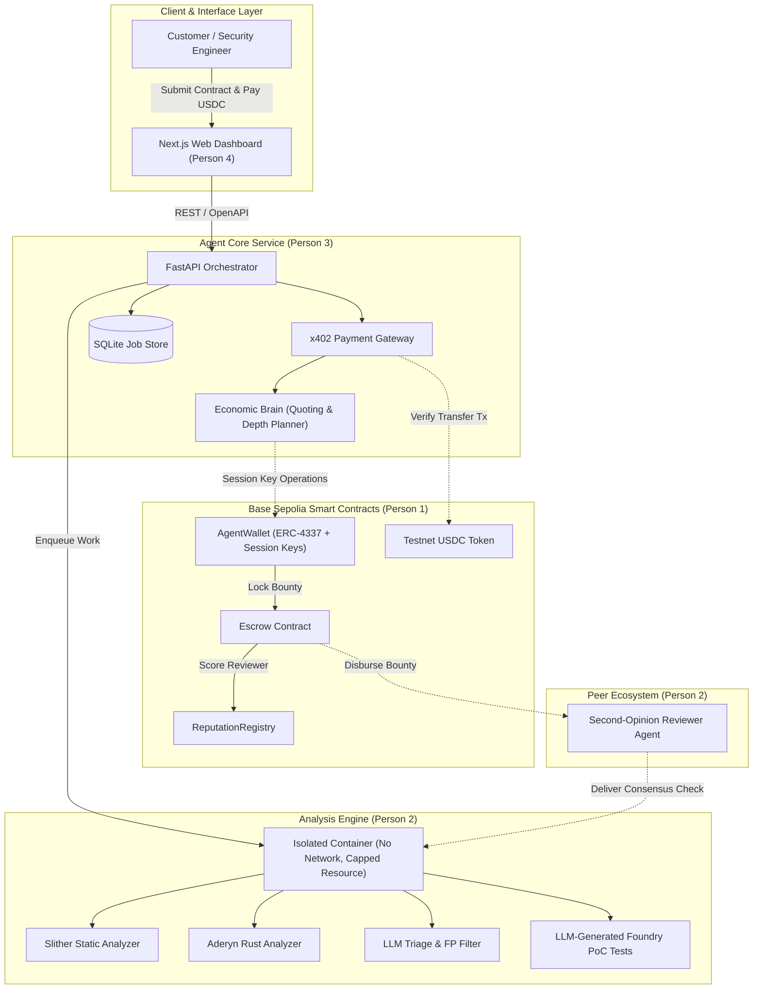

# AuditAgent

> Autonomous AI blockchain security triage agent running as a micro-business on Base Sepolia.

AuditAgent is an experimental, autonomous security intelligence agent engineered as an on-chain micro-enterprise. Users submit Solidity smart contracts along with payment in testnet USDC via an HTTP 402 ("Payment Required") protocol. The agent evaluates the submission, deploys containerized static analysis tools (Slither, Aderyn), performs LLM vulnerability triage, generates Foundry invariant and fuzz tests, optionally hires peer auditor agents through decentralized escrow, and delivers a ranked risk report while capturing surplus profit.

> **Important Positioning**: AuditAgent operates strictly as a **pre-audit automated triage and vulnerability discovery system**, never as a substitute for an accredited manual security audit. All on-chain interactions are permanently locked to testnet environments (Base Sepolia).

---

## Architecture Overview



---

## Team Split & Ownership

This monorepo is divided across 4 specialized roles:

| Person | Focus Area | Primary Directory | Git Branch |
|---|---|---|---|
| **Person 1** | Smart Contracts & Safety Guardrails | `contracts/` | `feat/contracts` |
| **Person 2** | Analysis Engine & Reviewer Agent | `analysis/`, `benchmarks/` | `feat/analysis` |
| **Person 3** | Agent Core, Economic Brain & x402 | `agent/` | `feat/agent-core` |
| **Person 4** | Web Dashboard & Security Attack Suite | `dashboard/`, `security-tests/` | `feat/dashboard` |

---

## Quickstart Guide

### 1. Prerequisites
- **Git** `>= 2.40`
- **Python** `>= 3.10`
- **Node.js** `>= 20.0.0`
- **Docker Engine** (for containerized static analysis execution)
- **Foundry** (`forge`, `cast`, `anvil`) installed via `foundryup`

### 2. Environment Setup
```bash
# Clone the repository
git clone <repo-url> auditagent
cd auditagent

# Run the automated bootstrap setup script
# On Linux/macOS:
bash scripts/setup.sh
# On Windows PowerShell:
.\scripts\setup.ps1
```

### 3. Local Development Mode
Start local Anvil testnet node, FastAPI Agent Core, and Next.js frontend concurrently:
```bash
# Linux/macOS:
bash scripts/dev.sh
# Windows PowerShell:
.\scripts\dev.ps1
```

Access services locally:
- **Web Dashboard**: `http://localhost:3000`
- **Agent API & Interactive Swagger**: `http://localhost:8000/docs`
- **Local Anvil RPC**: `http://127.0.0.1:8545`

---

## Repository Structure

```
auditagent/
├── README.md                  # Project overview, architecture, team layout
├── AGENTS.md                  # Guidelines and instructions for AI coding assistants
├── CONTRIBUTING.md            # Git branching rules, conventional commits, PR guidelines
├── .env.example               # Environment variables configuration template
├── LICENSE                    # Permissive educational open source license
├── .github/                   # GitHub Actions CI workflow, PR template, CODEOWNERS
├── docs/                      # Technical specifications, architecture, tasks, roadmap
├── shared/                    # Shared JSON schemas, contract ABIs, OpenAPI spec
├── contracts/                 # Foundry smart contract project (Person 1)
├── analysis/                  # Python sandboxed static & fuzz analysis engine (Person 2)
├── agent/                     # FastAPI core orchestration service & x402 gateway (Person 3)
├── dashboard/                 # Next.js App Router customer & operator interface (Person 4)
├── security-tests/            # Adversarial attack and security validation suite (Person 4)
├── benchmarks/                # Vulnerability detection benchmarks & datasets (Person 2)
└── scripts/                   # Setup, local development, and linting helper scripts
```
