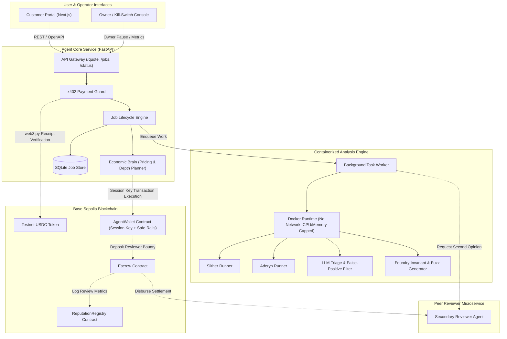

# AuditAgent Architecture Specification

## 1. System Overview

AuditAgent integrates distributed on-chain mechanics with a containerized AI analysis backend and a modern web dashboard.

---

## 2. Component Breakdown

### 2.1 Smart Contracts (`contracts/`)
- **`AgentWallet.sol`**:
  - Implements spending controls: `perTxCap`, `dailyCap`, and `reserveBalance`.
  - Grants time-limited session keys for the automated agent backend.
  - Rejects transactions sending value to addresses outside `vendorAllowlist`.
  - Pause mechanism callable by the contract owner.
- **`Escrow.sol`**:
  - Holds USDC collateral for second-opinion reviews.
  - Allows the primary agent to deposit bounty with an expiration timestamp.
  - Disburses funds to the reviewer upon submission of signed report hash, or refunds primary agent after timeout.
- **`ReputationRegistry.sol`**:
  - Maintains public on-chain performance metrics and historical accuracy scores.

### 2.2 Agent Core Service (`agent/`)
- Built on **FastAPI** with async background tasks and **SQLAlchemy** + **SQLite**.
- **x402 Paywall**: Intercepts unauthenticated or unpaid requests to `/jobs`, generating HTTP 402 responses containing recipient details and required token amounts.
- **Payment Verifier**: Uses `web3.py` to inspect transaction logs, verify token transfer values, and match the job ID embedded in the payment calldata.
- **Economic Brain**:
  - Calculates line-of-code metrics, estimated LLM tokens, and static analysis compute overhead.
  - Formulates pricing for `quick`, `standard`, and `deep` scan tiers.
  - Computes net profit margin and initiates reserve deposits to the owner wallet.

### 2.3 Analysis Engine (`analysis/`)
- Runs within an isolated **Docker container** configured with:
  - `--network none` (complete network disconnection during analysis to prevent data exfiltration).
  - CPU constraints (`--cpus 2.0`) and memory caps (`--memory 2048m`).
  - Timeouts (`timeout 180s`).
- **Slither & Aderyn**: Multi-engine static analysis to surface AST-level AST vulnerabilities.
- **LLM Triage**: Uses a provider-agnostic wrapper (Anthropic Claude 3.5 Sonnet by default, configurable to OpenAI) to evaluate raw tool findings, remove false positives, and write clear explanations.
- **Foundry Invariant / Fuzz Generator**: Synthesizes runnable Foundry tests targeting flagged functions to confirm exploitability.
- **Second-Opinion Reviewer**: Standalone service simulating an external auditor agent.

### 2.4 Web Dashboard (`dashboard/`)
- **Next.js 14 App Router** with TypeScript and Tailwind CSS.
- Integrates **wagmi** and **viem** for seamless Base Sepolia wallet connection.
- **Customer View**:
  - Solidity code paste or file upload.
  - Dynamic quote display.
  - One-click USDC approval and payment modal.
  - Real-time job tracking and interactive vulnerability report viewer.
- **Owner View**:
  - Agent wallet balance and daily allowance monitoring.
  - Financial P&L telemetry and historical scan margins.
  - Reasoning log viewer displaying LLM decisions.
  - Emergency Kill Switch / Pause button.
