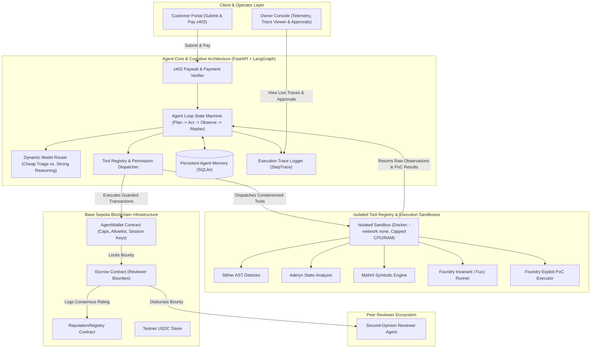
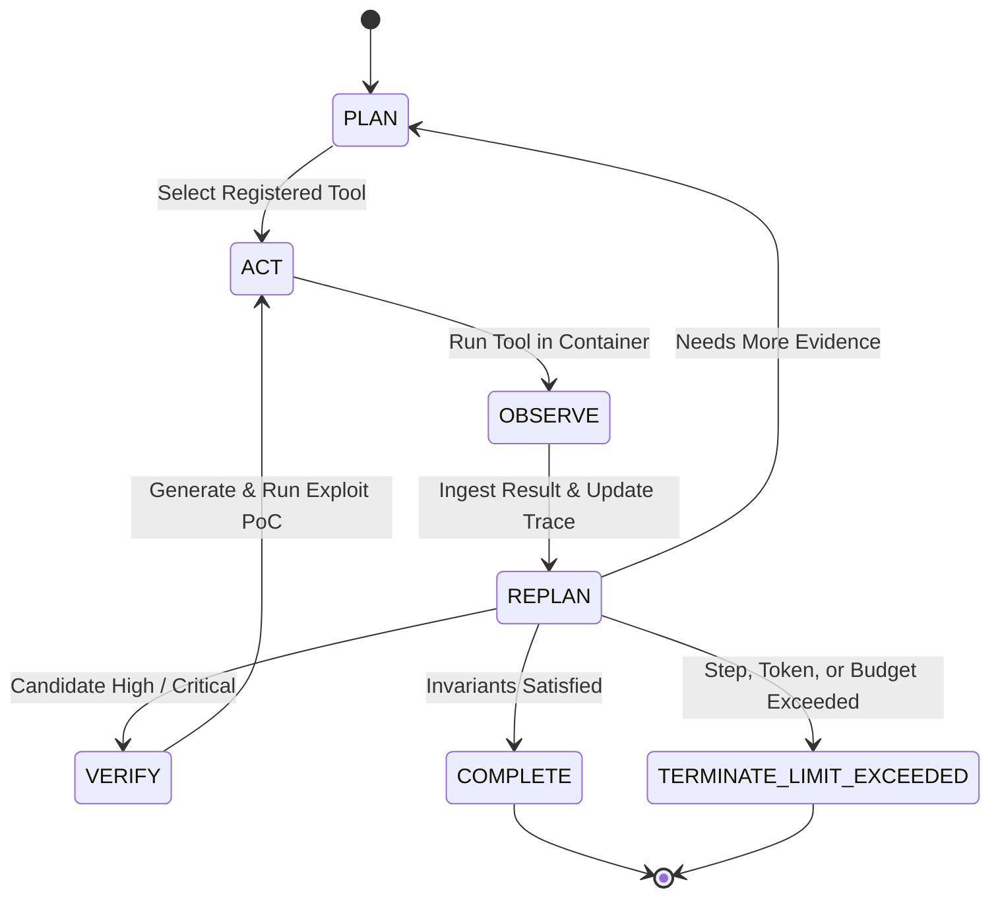

# AuditAgent Architecture Specification

## 1. System Overview

AuditAgent is engineered as an industry-standard autonomous agentic system rather than a naive LLM wrapper. It combines a deterministic **Plan -> Act -> Observe -> Replan** cognitive state machine, a typed **Tool Registry**, a **Verify-Before-Report** exploit synthesis pipeline, persistent **Agent Memory**, dynamic **Model Routing**, and real-time **Observability Tracing**.

---

## 2. Autonomous Agent Cognitive Architecture

### 2.1 The Agentic State Machine (LangGraph Loop)
Rather than a single prompt that generates an entire report, the agent operates in an iterative loop:
- **`PLAN`**: Evaluates contract source length, detected contract archetype (DeFi, Vault, Token, Governance), and past precision metrics from `tool_precision_matrix`. Selects the most cost-effective tool to run next.
- **`ACT`**: Calls the selected tool through the `ToolDispatcher`, routing prompts to the optimal model tier.
- **`OBSERVE`**: Parses the tool's structured output. Validates against JSON Schema.
- **`REPLAN`**: Ingests new findings, checks remaining budget, step limits, and token counters.
  - If a candidate `Critical` or `High` finding is discovered, transitions to `VERIFY`.
  - If budget ceiling (70% of revenue) or step limit (10 steps) is reached, transitions to `TERMINATE_LIMIT_EXCEEDED` and generates a best-effort report.
  - If triage goals are satisfied, transitions to `COMPLETE`.
- **`VERIFY`**: Calls a strong reasoning model to synthesize a runnable Foundry test (`testExploit()`). Executes the test inside the sandbox. Only tests that pass on-chain state corruption assertions mark the finding as `verified: true` with `High` confidence.

### 2.2 Tool Registry & Sandbox Policy
All agent capabilities are strictly encapsulated in a typed **Tool Registry**:
- Every tool defines a JSON Schema for input parameters.
- Tools have hardcoded execution timeouts (30s–120s) and estimated compute costs.
- Static and symbolic tools execute inside non-networked Docker containers (`--network none`, `--cpus 2.0`, `--memory 2048m`).
- Unregistered tools or dynamic code execution on the host machine are rejected by the dispatcher.

### 2.3 Dynamic Model Routing
To maximize gross margin while maintaining elite exploit synthesis:
- **Cheap / Fast Model (e.g. Claude 3.5 Haiku / GPT-4o-mini)**:
  - AST detector filtering, false positive triage, and JSON formatting.
  - Generates executive summaries from verified data.
  - Cost: ~$0.25 / 1M input tokens.
- **Strong Reasoning Model (e.g. Claude 3.5 Sonnet / GPT-4o)**:
  - Deep architectural vulnerability assessment.
  - Exploit synthesis: generating runnable Foundry PoC tests that target reentrancy, access control bypasses, and arithmetic bugs.
  - Cost: ~$3.00 / 1M input tokens.

### 2.4 Persistent Memory Subsystem
The agent persists operational memory in SQLite:
1. `job_outcomes`: Tracks past jobs, LOC, contract archetypes, costs, and profits.
2. `tool_precision_matrix`: Dynamically computes historical precision and recall per tool for each contract archetype. The planner uses this to skip noisy detectors on specific contract patterns.
3. `tier_cost_history`: Maintains rolling compute/token averages for dynamic quoting.

### 2.5 Observability & Trace View
Every cognitive cycle logs a `StepTrace` record capturing:
- Step number and state (`PLAN`, `ACT`, `OBSERVE`, `REPLAN`, `VERIFY`).
- Tool name, parameters, execution latency (ms), and cost ($).
- Model routed, prompt tokens, completion tokens.
- Natural language decision rationale.
- Exposed via `GET /jobs/{id}/traces` and rendered live in the Dashboard Owner View.

### 2.6 Multi-Layered Guardrails & Human Approvals
1. **Prompt Injection Boundary**: Customer Solidity code is wrapped in `<untrusted_solidity_code>` tags and treated strictly as passive data.
2. **On-Chain Financial Guardrails**: `perTxCap`, `dailyCap`, `reserveBalance`, and `vendorAllowlist` in `AgentWallet.sol`.
3. **Human-in-the-Loop Approval**: The agent pauses and prompts for owner signature if an on-chain escrow bounty exceeds $10.00 USDC or if the agent loop reaches step 9 without convergence.
