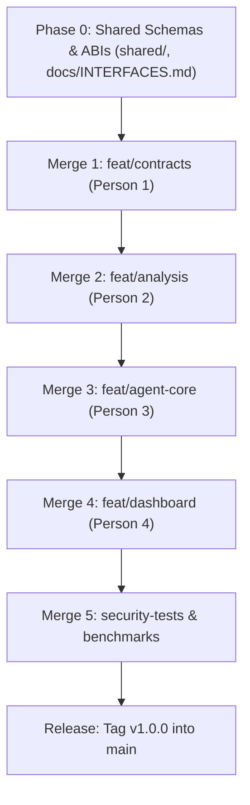

# Lead Engineer Merge and Integration Plan

This playbook provides the Lead Engineer with the sequential protocol, verification gates, conflict resolution guidelines, and release checklist for merging the 4 parallel feature branches into `develop` and releasing to `main`.

---

## 1. Sequential Merge Order

Merging must follow an explicit dependency sequence. Merging out of order causes broken dependencies and broken integration tests:

### Order Rationale:
1. **Shared Schemas & ABIs**: Ground-truth data types and function signatures must be locked.
2. **Contracts (`feat/contracts`)**: Produces compiled bytecode, verified ABIs in `shared/abis/`, and deployed addresses on local Anvil / Base Sepolia.
3. **Analysis Engine (`feat/analysis`)**: Produces the containerized analyzer and report generation pipeline conforming to `report.json`.
4. **Agent Core (`feat/agent-core`)**: Glues contracts (web3.py payment verification) with analysis execution and database persistence.
5. **Dashboard (`feat/dashboard`)**: Connects the Next.js UI to the now-functional agent endpoints and on-chain wallet.
6. **Security & Benchmarks**: Executes end-to-end adversarial attack suite and dataset evaluations against the integrated system.

---

## 2. Integration Verification Protocol (Per-Merge Gate)

Execute these checks immediately after merging each feature branch into `develop`:

### Gate 1: After `feat/contracts` Merge
- Run `forge test -vvv` in `contracts/` (must pass 100%, >90% coverage).
- Verify exported ABIs in `shared/abis/` match current contract signatures.
- Verify Anvil deployment script deploys mock USDC, `AgentWallet`, `Escrow`, and `ReputationRegistry`.

### Gate 2: After `feat/analysis` Merge
- Run `pytest tests/ -v` inside `analysis/`.
- Test Docker image build: `docker build -t auditagent-analysis-sandbox:test analysis/`.
- Run mock analysis script on `benchmarks/datasets/sample_contracts/SimpleReentrancy.sol` and validate output against `shared/schemas/report.json`.

### Gate 3: After `feat/agent-core` Merge (Milestone: End-to-End Paid Job)
- Run `pytest tests/ -v` inside `agent/`.
- Start local Anvil testnet node and launch FastAPI service.
- Execute simulated customer workflow:
  1. Call `POST /jobs` without header -> Verify HTTP 402 with correct payload.
  2. Simulate USDC payment on Anvil.
  3. Call `POST /jobs` with `X-Payment-Proof: <txHash>` -> Verify HTTP 201.
  4. Poll `GET /jobs/{id}` until status is `delivered`.
  5. Fetch `GET /jobs/{id}/report` and verify schema.

### Gate 4: After `feat/dashboard` Merge
- Run `npm test` and `npm run build` in `dashboard/`.
- Open dashboard at `http://localhost:3000`. Test:
  - Wallet connection (wagmi / Base Sepolia).
  - Contract submission and USDC payment modal.
  - Job tracking page with live status updates.
  - Owner dashboard: balance view, P&L, emergency pause button.

### Gate 5: After Security & Benchmarks Merge
- Run `pytest security-tests/tests/ -v`.
- Verify: prompt injection defense succeeds, malformed payment proofs rejected, sandbox isolation blocks unauthorized system calls.

---

## 3. Conflict Resolution Strategy

1. **Schema & ABI Conflicts**:
   - `shared/` files are canonical. Any conflict between a feature branch and `develop` in `shared/` must be resolved in favor of the approved RFC.
   - Run `python -c "import json; json.load(open('shared/schemas/finding.json'))"` to guarantee JSON validity.
2. **Database Migration Conflicts**:
   - SQLite schema changes in `agent/agent/models.py` must use Alembic migration scripts. If two branches added conflicting models, generate a unified merge migration.
3. **Environment & Config Conflicts**:
   - Ensure `.env.example` contains all newly introduced environment variables with safe default placeholders.

---

## 4. Final Release Checklist (Week 10 Freeze)

- [ ] All unit tests pass across all 4 modules (`contracts`, `analysis`, `agent`, `dashboard`).
- [ ] Security attack suite passes with zero high/critical vulnerabilities.
- [ ] Contract gas report generated and committed in `contracts/gas-report.txt`.
- [ ] Clean contract deployment executed on Base Sepolia testnet with verified addresses documented in `docs/PROJECT_BRIEF.md` and `.env.example`.
- [ ] Live demo scenario dry run executed following `docs/DEMO_SCRIPT.md`.
- [ ] Slides and final report draft finalized in `docs/`.
- [ ] Tag git release: `git tag -a v1.0.0 -m "AuditAgent University PBL Final Release"` and push tags.
